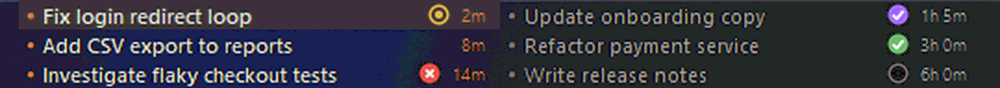
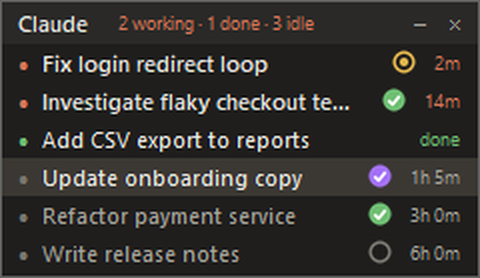

<h1 align="center">Claude Taskbar</h1>

<p align="center">
  <b>Stop forgetting the Claude sessions you started.</b><br>
  An always-visible overview on the Windows taskbar: what's working, what's done and waiting for you, and how long it's been sitting there.
</p>

<p align="center">
  
  
  
  
  <a href="LICENSE"></a>
</p>

<p align="center">
  
</p>

<p align="center"><sub>Live on the taskbar: a session finishes (green <i>done</i>), you click another (the highlight follows), a failing PR goes green.</sub></p>

---

## Why

Claude Code makes it easy to start a session, kick off a task and move on. The catch: you start a few,
switch to something else, and some of them are left hanging. Claude finished hours ago and is waiting
for your answer, but you've forgotten the session exists.

**Claude Taskbar** keeps every running session in view, in the empty part of your taskbar, so nothing
slips through:

- **Nothing out of sight.** Your sessions sit on the taskbar all the time, not buried in a window
  you have to open.
- **See who's waiting on you.** A session Claude has finished shows *done* in green, then how long it's
  been idle, so one that's sat there for hours stands out.
- **One click to pick it back up.** Click a session to jump straight to it in the Claude app.
- **Know where each one ended up.** The PR icon shows whether its work was merged, is still running
  checks, or failed.

## What you see

Each line is one session: **status dot**, **name**, **PR status** and **time**.

| | Status | | Pull request |
|:-:|---|:-:|---|
|  | **Working**: Claude is on it (shows for how long) |  | checks passed |
|  | **Done**: just finished (green for 2 minutes) |  | a check failed |
|  | **Idle**: waiting (shows for how long) |  | checks running |
| | |  | merged |
| | |   | closed / draft |

- **Up to 6 sessions**, working ones first, then just-finished, then the most recent.
- **The highlighted row** is the session you're most likely looking at: the one you last typed in,
  or last clicked in the widget.
- **PR status** comes from the branch each session is on, via the GitHub CLI.

## Features

- 🖱️ **Click a session to open it** in the Claude desktop app.
- 📌 **Docks on the taskbar**, in the empty space left of the tray, with a see-through background.
- ↔️ **Drag sideways** to move it along the taskbar; it remembers where you put it.
- 🎬 **Gets out of the way** of full-screen videos and games, and comes back after.
- 🪟 **Prefer a floating window?** Untick *Dock on taskbar* in the right-click menu:

  

- 🔒 **Local and read-only.** It only reads Claude Code's own status files; nothing is sent anywhere
  except the `gh` PR lookups, made with your own GitHub login.

## Install

You need **Windows 11** and **Python 3.12+** from [python.org](https://www.python.org/downloads/)
(it includes Tkinter).

```powershell
git clone https://github.com/nubpro/claude-taskbar.git
cd claude-taskbar
pip install pillow          # for the PR icons (optional)
pythonw claude_sessions_widget.pyw
```

Optional:

- [GitHub CLI](https://cli.github.com/), signed in with `gh auth login`, for PR status.
- The [Claude desktop app](https://claude.ai/download), for click-to-open.

### Start it with Windows

Run this once from the `claude-taskbar` folder in PowerShell. It puts a shortcut in your Startup folder:

```powershell
$s = (New-Object -ComObject WScript.Shell).CreateShortcut("$([Environment]::GetFolderPath('Startup'))\Claude Taskbar.lnk")
$s.TargetPath = (Get-Command pythonw).Source
$s.Arguments = "`"$PWD\claude_sessions_widget.pyw`""
$s.WorkingDirectory = "$PWD"
$s.Save()
```

To stop it starting with Windows, turn it off in **Task Manager → Startup apps**, or delete the shortcut.

## Controls

| Do this | To |
|---|---|
| **Click** a session | open it in Claude |
| **Drag** sideways | move it along the taskbar |
| **Right-click** | dock / float, show idle sessions, opacity, reset position, exit |

## How it works

- Claude Code writes a small status file per running session to `%USERPROFILE%\.claude\sessions\`.
  The widget reads the `.json` ones every 3 seconds (the `.key` files beside them are never opened).
- "Last typed in" comes from the end of each session's transcript in `%USERPROFILE%\.claude\projects\`.
- PR status is `gh pr view` in each session's folder, on a background thread, every 90 seconds.
- Sessions open through the desktop app's own link: `claude://code/continue?session=<id>`.
- Your position and settings live in `config.json`, and errors in `widget.log`, next to the script.

## Known limits

- **Start menu:** while Start or search is open, Windows 11 draws the taskbar above every other
  window, so the widget is covered until it closes. Windows 11 doesn't let apps put windows inside
  the taskbar itself.
- **Highlight:** the Claude app doesn't expose which session is on screen. If you switch sessions in the
  app's sidebar and only read, the highlight stays put until you type there or click it in the widget.

## Regenerating the previews

The images above use made-up sessions. To rebuild them, close the widget and run:

```powershell
python tools/make_previews.py
```

## License

[MIT](LICENSE): free to use, change and share, including commercially. Just keep the copyright notice.
